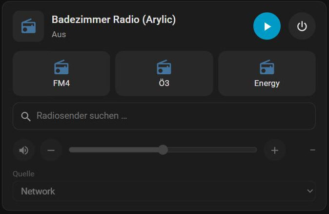

# Radio-Karte

Lautsprecher mit Radiosendern: Play startet den Standardsender, Sender-Tasten, Lautstärke und Quelle



## Installation

### Über den Marketplace (Home Assistant 2026.11 und neuer)

1. **Einstellungen** → **Marketplace** → **Aus Link hinzufügen**.
2. Die Adresse dieses Repositorys eintragen, Kategorie **Dashboard**.
3. **Radio-Karte** installieren. Die Ressource wird dabei automatisch eingetragen.

### Über HACS (ältere Versionen)

**HACS** → ⋮ → **Benutzerdefinierte Repositories** → Adresse dieses Repositorys, Typ **Dashboard** → installieren.

### Manuell

`radio-karte.js` nach `/config/www/` kopieren und unter **Einstellungen** → **Dashboards** → ⋮ → **Ressourcen**
als JavaScript-Modul `/local/radio-karte.js` eintragen.

## Verwendung

```yaml
type: custom:radio-karte
```

## Konfiguration

```
Radio-Karte: Netzwerk-Lautsprecher/Verstaerker (z. B. Arylic) mit Radiosendern in einer Karte.
Play startet den Standardsender (erster Sender), wenn nichts laeuft; laeuft etwas, pausiert er.
Sender werden ueber einen Chromecast-Eintrag gestartet (play_media), Lautstaerke/Pause/Quelle ueber das Geraet.

  type: custom:radio-karte
  entity: media_player.badezimmer_arylic_la50     # Geraet (Lautstaerke, Pause, Quelle)
  cast: media_player.arylic_la50_71524d_3         # Chromecast desselben Geraets (Sender starten)
  name: Badezimmer Radio                          # optional
  power: switch.steckdose_badezimmer              # optional, Ein/Aus (z. B. Steckdose des Verstaerkers)
  suche: true                                     # optional, Sendersuche (Radio Browser), laender: [AT] (Standard)
  sender:                                         # erster = Standard fuer Play
    - { name: FM4, id: "media-source://radio_browser/1e13ed4e-daa9-4728-8550-e08d89c1c8e7", icon: mdi:radio }
      # optional: titel = Text, an dem der laufende Sender erkannt wird (Standard: name)
```

## Lizenz

MIT
